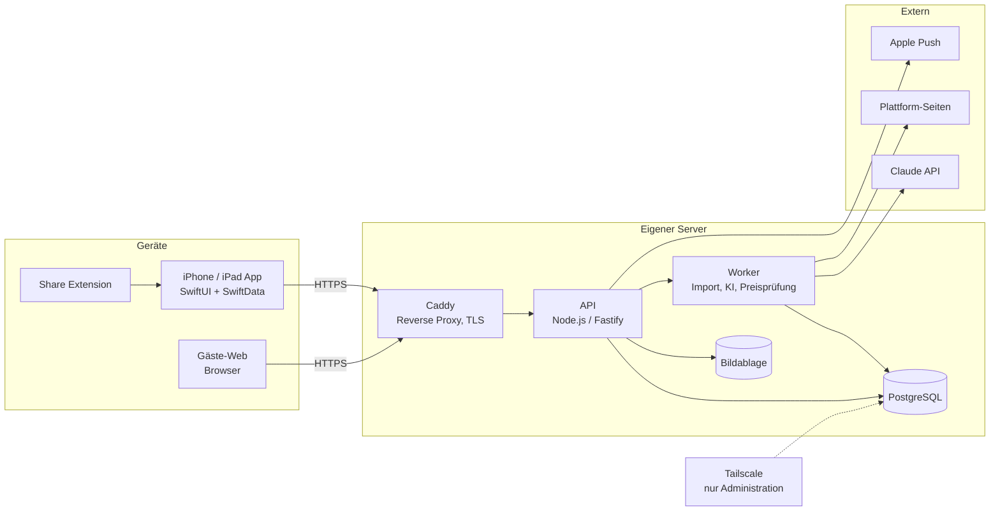
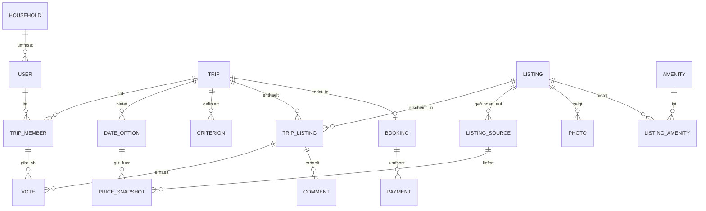

# Konzept: Ferienhaus-Planer für Familie und Freunde

**Arbeitstitel:** Travel Planner
**Stand:** 16.11.2026, Version 0.5 (Ausbau zum Begleiter für die ganze Reise, Kapitel 15)
**Status:** Recherche weitgehend umgesetzt (Backend und iOS-App), übrige Phasen in Konzeption

---

## 1. Management Summary

Die Suche nach einem Ferienhaus für mehrere Familien scheitert selten am Angebot, sondern an der Organisation: Links liegen verstreut in WhatsApp-Gruppen, jede Plattform zeigt Preise und Ausstattung anders, niemand weiß mehr, welches Haus schon verworfen wurde, und die Abstimmung zieht sich über Wochen.

Der Travel Planner löst genau das. Er ist **keine weitere Suchmaschine**, sondern das gemeinsame Arbeitsbuch der Reisegruppe: Fundstücke von beliebigen Plattformen werden per Teilen-Menü eingesammelt, automatisch in einen einheitlichen Steckbrief übersetzt, nebeneinander verglichen, gemeinsam bewertet und bis zur Buchung verfolgt.

Die Kernempfehlungen in Kürze:

| Thema | Empfehlung |
|---|---|
| App | Native iOS/iPadOS-App in **Swift und SwiftUI**, mit Share Extension als wichtigstem Einstiegspunkt |
| Backend | **TypeScript (Node.js, Fastify)** als Docker-Stack in einer eigenen Linux-VM auf dem Server |
| Datenbank | **PostgreSQL** auf dem eigenen Server, nie direkt erreichbar, nur über die API |
| Erreichbarkeit | API über HTTPS aus dem Internet, zum Start über Tailscale Funnel ohne offene Ports, Administration nur über Tailscale |
| Datenimport | Teilen-Menü plus KI-gestützte Extraktion. Offizielle APIs der großen Plattformen stehen Privatprojekten praktisch nicht offen |
| Mitmachen ohne App | Abstimmung für Gäste über einen Web-Link, damit auch Android-Nutzer und Großeltern teilnehmen können |
| Verteilung | TestFlight, kein öffentlicher App-Store-Auftritt nötig |

---

## 2. Ausgangslage und Ziel

### 2.1 Das Problem heute

- Recherche auf vielen Plattformen parallel (Airbnb, Booking.com, FeWo-direkt/Vrbo, Holidu, HomeToGo, Interhome, Novasol, regionale Anbieter, private Webseiten).
- Mehrere Reisen gleichzeitig in Planung, mit unterschiedlichen Zeiträumen und wechselnden Mitreisenden.
- Angaben sind nicht vergleichbar: Der eine Anbieter nennt den Preis pro Nacht, der andere den Gesamtpreis, beim dritten kommen Endreinigung, Bettwäsche und Strom nach Verbrauch dazu.
- Abstimmung läuft über Messenger. Links gehen unter, Meinungen sind nicht nachvollziehbar, Entscheidungen werden vertagt.
- Wissen geht verloren: Welches Haus war letztes Jahr in der engeren Wahl? Warum haben wir es verworfen?

### 2.2 Zielbild

> In unter zehn Sekunden vom Fund zum gespeicherten, vergleichbaren Steckbrief. In unter zwei Minuten vom Vergleich zur Abstimmung in der Gruppe.

### 2.3 Abgrenzung

Der Schwerpunkt liegt auf Ferienhäusern. **Hotels und Pauschalreisen** können ebenfalls gesammelt und verglichen werden, weil je nach Reise beides infrage kommt (Entscheidung vom 15.11.2026). Sie erhalten einen eigenen Steckbrief, siehe 4.2.

Die App **bucht nicht** und **ersetzt keine Plattform**. Gebucht wird immer beim Anbieter, die App führt per Link dorthin. Das hält das Projekt rechtlich und technisch schlank.

---

## 3. Nutzer und Nutzungserlebnis

### 3.1 Rollen

| Rolle | Beschreibung | Zugang |
|---|---|---|
| **Rechercheur** | Sucht aktiv, sammelt Häuser, pflegt Details. Meist ein bis zwei Personen pro Reise. | App |
| **Mitentscheider** | Schaut sich die Vorauswahl an, bewertet, kommentiert. | App oder Web-Link |
| **Gast** | Stimmt einmalig ab, ohne Konto und ohne Installation. | Web-Link |
| **Organisator** | Legt die Reise an, lädt ein, setzt Fristen, hält die Buchung fest. | App |

### 3.2 Der rote Faden: fünf Schritte

```
Sammeln  →  Ordnen  →  Vergleichen  →  Abstimmen  →  Entscheiden und buchen
```

1. **Sammeln:** In der Airbnb-App oder in Safari auf „Teilen" tippen, Travel Planner wählen, Reise auswählen, fertig. Die Aufbereitung läuft im Hintergrund.
2. **Ordnen:** Jedes Haus hat einen Status (Neu, Engere Wahl, Favorit, Verworfen, Gebucht). Verworfene Häuser bleiben mit Begründung erhalten, damit niemand sie erneut vorschlägt.
3. **Vergleichen:** Einheitlicher Steckbrief und eine Vergleichstabelle, die Unterschiede hervorhebt.
4. **Abstimmen:** Jeder bewertet in seinem Tempo. Der Organisator sieht jederzeit, wer noch fehlt.
5. **Entscheiden und buchen:** Die App zeigt das Ergebnis, führt zum Anbieter und hält danach Buchungsdaten, Zahlungsfristen und Stornobedingungen fest.

### 3.3 UX-Leitlinien

- **Erfassen muss schneller sein als ein Link in WhatsApp.** Sonst nutzt es niemand. Deshalb ist die Share Extension das wichtigste Bauteil der App.
- **Die App arbeitet auch mit unvollständigen Daten.** Ein Haus ist sofort gespeichert, auch wenn erst Titel und Bild bekannt sind. Fehlende Angaben werden sichtbar markiert und können ergänzt werden.
- **iPad für die Analyse, iPhone für unterwegs.** Auf dem iPad eine dreispaltige Ansicht mit Vergleichstabelle und Karte, auf dem iPhone Karten-Stapel und schnelle Bewertung.
- **Niedrige Hürde für Mitreisende.** Wer nur abstimmen soll, braucht weder Konto noch App.
- **Ehrliche Daten.** Jeder Preis trägt Datum und Quelle. Automatisch erkannte Angaben sind als solche gekennzeichnet und korrigierbar.

### 3.4 Zentrale Ansichten

| Ansicht | Inhalt |
|---|---|
| **Reisen-Übersicht** | Alle laufenden Planungen mit Fortschritt („7 Häuser, 3 Favoriten, 2 Stimmen fehlen"), dazu das Archiv |
| **Reise-Dashboard** | Zeiträume, Mitreisende, Muss-Kriterien, Budget, Aktivitäten, nächste Frist |
| **Häuser-Liste** | Karten mit Bild, Gesamtpreis, Preis pro Person und Nacht, Ampel für Muss-Kriterien, Stimmungsbild |
| **Steckbrief** | Standardisierte Detailseite, siehe Abschnitt 4.2 |
| **Vergleich** | Zwei bis fünf Häuser nebeneinander, Unterschiede farblich hervorgehoben, Fotos nach Raumtyp |
| **Karte** | Alle Kandidaten mit Preis-Pins, Entfernungen zu Strand, Supermarkt, Flughafen |
| **Abstimmung** | Schnellbewertung per Wischen, Ergebnisübersicht, offene Stimmen |
| **Aktivitäten** | Chronik: Wer hat was hinzugefügt, bewertet, kommentiert, welcher Preis hat sich geändert |

---

## 4. Funktionsumfang

Priorität nach MoSCoW: **M** = Muss (MVP), **S** = Soll (Ausbaustufe 2), **K** = Kann (später).

### 4.1 Reisen und Gruppen

| Funktion | Prio |
|---|---|
| Reise anlegen mit Titel, Region, Personenzahl (Erwachsene, Kinder, Haustiere) | M |
| Mehrere Zeitraum-Varianten pro Reise („Pfingsten" oder „erste Sommerferienwoche") | M |
| Mitreisende per Link einladen, Gruppierung nach Familien | M |
| Muss- und Wunsch-Kriterien pro Reise (zum Beispiel mindestens 4 Schlafzimmer, Hund erlaubt, Pool) | S |
| Budgetrahmen gesamt und pro Familie | S |
| Archiv vergangener Reisen mit eigenem Fazit („Würden wir wieder buchen?") | S |
| Reiseübergreifende Merkliste („Für irgendwann") | K |

### 4.2 Der standardisierte Steckbrief

Herzstück der Vergleichbarkeit. Jedes Haus wird, unabhängig von der Plattform, in dasselbe Raster übersetzt:

| Bereich | Felder |
|---|---|
| **Basis** | Titel, Objekttyp, Plattform und Link, Gastgeber, Anzahl und Schnitt der Bewertungen |
| **Kapazität** | Maximale Personenzahl, Schlafzimmer, Betten nach Typ, Badezimmer, Wohnfläche, Grundstück |
| **Lage** | Adresse oder ungefähre Position, Entfernung zu Strand, Ort, Supermarkt, Flughafen, Fahrzeit von zu Hause |
| **Ausstattung** | Einheitlicher Katalog: Pool, Sauna, Kamin, Spülmaschine, Waschmaschine, WLAN, Klimaanlage, Grill, Wallbox, Kinderbett, Hochstuhl, eingezäunter Garten, Barrierefreiheit und weitere |
| **Regeln** | Haustiere, Rauchen, An- und Abreisetage, Mindestaufenthalt, Check-in-Zeiten |
| **Kosten** | Grundpreis, Endreinigung, Servicegebühr, Kurtaxe, Bettwäsche, Nebenkosten nach Verbrauch, Kaution, **echter Gesamtpreis**, Preis pro Person und Nacht |
| **Bedingungen** | Stornoregeln, Anzahlung, Fälligkeit der Restzahlung |
| **Fotos** | Galerie, sortiert nach Raumtyp (Außen, Wohnen, Küche, Schlafen, Bad, Aussicht) |
| **Eigene Notizen** | Freitext, Tags, Vor- und Nachteile, offene Fragen an den Vermieter |

Der „echte Gesamtpreis" ist ein wesentlicher Mehrwert. Gerade bei dänischen und niederländischen Anbietern kommen Strom, Wasser und Endreinigung oft erst nachträglich dazu und verzerren jeden Vergleich.

**Hotels und Pauschalreisen** nutzen dasselbe Raster für Basis, Lage, Bewertung, Kosten und Notizen. Statt Kapazität und Hausausstattung treten diese Felder hinzu:

| Bereich | Felder |
|---|---|
| **Hotel** | Sterne, Zimmertyp, Verpflegung, Hotelausstattung (Pools, Kinderbetreuung, Strandlage) |
| **Reise** | Veranstalter, Abflughafen, Flugzeiten, Direktflug, Reisedauer, Transfer enthalten |
| **Preis** | Reisepreis gesamt für alle Personen, Preis pro Person, Spanne je Abflugtermin |

In der Vergleichsansicht werden Ferienhäuser und Pauschalreisen getrennt gegenübergestellt. Gemeinsam vergleichbar bleiben Gesamtkosten der Reise, Lage, Bewertung und das Stimmungsbild der Gruppe. Bei Ferienhäusern rechnet die App dafür auf Wunsch geschätzte Anreisekosten hinzu.

### 4.3 Import und Erfassung

| Funktion | Prio |
|---|---|
| Teilen-Menü (Share Extension) aus Safari und aus den Apps der Plattformen | M |
| Link einfügen oder aus der Zwischenablage übernehmen | M |
| Automatische Vorschau (Titel, Bild, Beschreibung) aus den Metadaten der Seite | M |
| KI-gestützte Extraktion in den Steckbrief | M |
| Manuelles Ergänzen und Korrigieren aller Felder | M |
| Screenshot-Import: Foto der Preisübersicht wird ausgelesen | S |
| Erkennen von Dubletten, auch wenn dasselbe Haus auf mehreren Plattformen steht | S |
| Buchungsbestätigung per E-Mail weiterleiten und auslesen lassen | K |

### 4.4 Vergleichen

| Funktion | Prio |
|---|---|
| Favoriten und Status pro Haus | M |
| Sortieren und Filtern nach Preis, Schlafzimmern, Bewertung, Status | M |
| Vergleichstabelle nebeneinander mit Hervorhebung der Unterschiede | M |
| Ampel für Muss-Kriterien („erfüllt 5 von 6") | S |
| Kartenansicht mit Entfernungen | S |
| Foto-Vergleich nach Raumtyp (Küche neben Küche) | S |
| Gewichtete Punktwertung nach eigenen Kriterien | K |

### 4.5 Zusammenarbeit und Abstimmung

| Funktion | Prio |
|---|---|
| Einfache Bewertung: Ja, Vielleicht, Nein | M |
| Kommentare pro Haus | M |
| Übersicht, wer schon abgestimmt hat | M |
| Push-Mitteilungen bei neuen Häusern, Kommentaren, Abstimmungen | S |
| Abstimmung per Web-Link ohne App | S |
| Abstimmungsfrist mit Erinnerung | S |
| Veto-Recht („Für uns ein Ausschlusskriterium") | S |
| Rangfolge-Wahl für die Endrunde (jeder ordnet die Top 3) | K |
| Bewertung nach Einzelkriterien (Lage, Ausstattung, Preis, Bauchgefühl) | K |

### 4.6 Preise und Verfügbarkeit

| Funktion | Prio |
|---|---|
| Preis mit Datum, Zeitraum und Personenzahl manuell festhalten | M |
| Preisverlauf als Kurve | S |
| „Preis jetzt prüfen": öffnet das Inserat in der App und liest den aktuellen Stand aus | S |
| Automatische regelmäßige Prüfung für Favoriten, mit Mitteilung bei Änderungen | K |
| Hinweis „Nicht mehr verfügbar" | K |

Zur Machbarkeit der automatischen Prüfung siehe Abschnitt 6.4.

### 4.7 Nach der Entscheidung

| Funktion | Prio |
|---|---|
| Buchung festhalten: Bestätigungsnummer, Zahlungen, Fristen | S |
| Kostenaufteilung nach Familien oder Köpfen, Kinder gewichtet | S |
| Erinnerung an Restzahlung und an die letzte kostenlose Stornierung | S |
| Zimmerverteilung: Wer schläft wo | K |
| Export als PDF oder Kalendereintrag | K |

---

## 5. Kreative Erweiterungen

Ideen, die über die Anforderung hinausgehen und das Erlebnis deutlich aufwerten können:

1. **Gemeinsame Ferien finden.** Abgleich der Schulferien nach Bundesland (frei verfügbare Daten, zum Beispiel OpenHolidays) für alle beteiligten Familien. Die App schlägt die Wochen vor, in denen alle können.
2. **KI-Zusammenfassung der Gästebewertungen.** Drei Stärken, drei Schwächen, wiederkehrende Warnsignale („hellhörig", „Pool im Juni noch kalt", „steile Zufahrt").
3. **Kostenfallen-Radar.** Automatischer Hinweis, wenn Nebenkosten fehlen oder ungewöhnlich hoch sind.
4. **Fragen an den Vermieter.** Die App sammelt offene Punkte aus den Kommentaren und formuliert daraus eine Nachricht.
5. **Wisch-Modus.** Neue Häuser im Stapel durchgehen und in Sekunden bewerten. Ideal für Mitentscheider, die keine Tabellen mögen.
6. **Entscheidungsassistent.** „Haus A erfüllt alle Muss-Kriterien, hat vier von fünf Stimmen und liegt 300 € unter dem Budget. Haus B gefällt allen, aber Familie M. hat ein Veto wegen des fehlenden Zauns."
7. **Klima-Check.** Typische Temperatur, Regentage und Wassertemperatur für Region und Zeitraum aus historischen Wetterdaten (zum Beispiel Open-Meteo).
8. **Anreise-Vergleich.** Fahrzeit für jede Familie von ihrem Wohnort, über Apple Maps.
9. **Familien-Gedächtnis.** Jedes je betrachtete Haus bleibt auffindbar. Nach drei Jahren entsteht eine eigene, wertvolle Sammlung.
10. **Widget und Live-Aktivität.** Stand der Abstimmung auf dem Home-Bildschirm („3 von 5 haben abgestimmt").
11. **Plattform-Preisvergleich.** Wenn dasselbe Haus auf mehreren Plattformen gefunden wurde, zeigt die App den günstigsten Weg.
12. **Zusammenfassung zum Weiterleiten.** Schön gestaltete Übersicht der Top 3 als Bild oder PDF für die Familiengruppe im Messenger.

---

## 6. Datenquellen: Was bei den Plattformen wirklich geht

Dies ist der Punkt mit dem größten Risiko im Projekt, deshalb hier eine nüchterne Einschätzung.

### 6.1 Offizielle APIs

| Plattform | Lage | Fazit |
|---|---|---|
| **Airbnb** | Keine öffentliche API. Die bestehende Schnittstelle ist für zugelassene Software-Partner auf Gastgeberseite gedacht (Channel Manager, Verwaltungssoftware). | Für uns nicht nutzbar |
| **Booking.com** | Die Demand API richtet sich an freigeschaltete Affiliate-Partner mit kommerziellem Hintergrund. | Für ein privates Projekt unrealistisch |
| **Vrbo / FeWo-direkt** (Expedia Group) | Schnittstellen nur für Vertriebspartner mit Vertrag. | Nicht nutzbar |
| **HomeToGo, Holidu** (Metasuchen) | Partner- und Affiliate-Programme, zum Teil mit Datenfeeds. | Theoretisch möglich, Aufwand und Auflagen stehen in keinem Verhältnis |
| **Novasol**, Interhome, Belvilla und ähnliche | Teils Produktfeeds über Affiliate-Netzwerke, gedacht für Vermittler. | Nicht eingeplant, Import über Link |
| **Check24** | Vergleichsportal, das Angebote anderer Anbieter bündelt. Keine Schnittstelle für Privatnutzer. | Import über Link. Dasselbe Haus taucht hier oft zusätzlich zu Novasol oder FeWo-direkt auf, die Dubletten-Erkennung ist dafür wichtig |
| **Drittanbieter** (Scraping-Dienste) | Liefern Daten gegen Gebühr, bewegen sich aber selbst in der Grauzone und brechen bei Änderungen der Plattformen. | Nicht als Fundament geeignet |

**Ergebnis:** Eine saubere API-Anbindung der großen Plattformen ist für ein privates Projekt derzeit nicht erreichbar. Die konkreten Zugangsbedingungen ändern sich gelegentlich und sollten vor Beginn von Ausbaustufe 3 noch einmal geprüft werden. Das Konzept ist bewusst so angelegt, dass es **ohne** solche APIs vollständig funktioniert.

### 6.2 Der empfohlene Weg: nutzergeführter Import

Statt Plattformen massenhaft automatisiert abzufragen, verarbeitet die App nur Seiten, die ein Mensch gerade selbst aufgerufen hat. Das ist robuster, weil keine Bot-Sperren greifen, und deutlich zurückhaltender gegenüber den Plattformen.

| Stufe | Quelle | Liefert | Zuverlässigkeit |
|---|---|---|---|
| **1** | Geteilter Link, Abruf der Vorschau-Metadaten (Open Graph) durch den Server | Titel, Hauptbild, Kurzbeschreibung, Plattform, Objekt-ID | Hoch |
| **2** | Teilen aus **Safari**: Die Share Extension darf den Inhalt der gerade geöffneten Seite mitgeben | Vollständiger Seiteninhalt inklusive strukturierter Daten (JSON-LD), Preis für den gewählten Zeitraum | Hoch |
| **3** | Teilen aus einer **Plattform-App**: Es kommt nur der Link an. Die App öffnet das Inserat in einer eingebetteten Webansicht und liest den Inhalt dort aus | Wie Stufe 2 | Mittel bis hoch |
| **4** | **KI-Extraktion**: Ein Sprachmodell übersetzt den Seiteninhalt in das Steckbrief-Schema | Normalisierte Felder, Ausstattung im Einheitskatalog, Kostenbestandteile | Hoch, mit Kennzeichnung unsicherer Felder |
| **5** | Screenshot oder Foto, ausgelesen per Bildanalyse | Preisaufstellung, einzelne Angaben | Mittel |
| **6** | Manuelle Eingabe | Alles | Immer verfügbar |

Der Vorteil der KI-Extraktion: Es muss **kein eigener Parser pro Plattform** gepflegt werden. Auch die Webseite eines privaten Vermieters wird verstanden. Ändert eine Plattform ihr Layout, funktioniert der Import in aller Regel weiter. Die Kosten liegen bei einem kleinen, schnellen Modell im Bereich von etwa einem Cent pro Inserat.

### 6.3 Ergebnis des Machbarkeitstests

Am 15.11.2026 wurden fünf echte Links vom Server aus getestet, mit einfachem Abruf und mit einem echten Browser, je Seite höchstens fünf Abrufe. Bot-Sperren wurden nicht umgangen.

| Plattform | Abruf vom Server | Ergebnis | Füllgrad des Steckbriefs |
|---|---|---|---|
| **Novasol** | Vollständig, schon per einfachem Abruf | Fast alle Felder aus strukturierten Daten, inklusive Bettenaufteilung und Nebenkosten. Es fehlen Bewertungen und der Preis für einen konkreten Zeitraum | 74 % |
| **Airbnb** | Vollständig, Gesamtpreis nur mit echtem Browser | Stammdaten strukturiert, Ausstattung und Flächen nur aus dem Text des Gastgebers. Nur ein Teil der Ausstattung sichtbar | 71 % |
| **Check24** (Pauschalreise) | Vollständig, Preise nur mit echtem Browser | Hoteldaten strukturiert, Preis, Flug und Storno aus dem sichtbaren Text | 75 % |
| **FeWo-direkt** | Gesperrt | Nur Bruchstücke. Objekt, Zeitraum und Personen aus dem Link | 43 % |
| **Casamundo** | Gesperrt | Nichts von der Seite. Objekt, Personen und Preis aus dem Link | 19 % |

**Folgerungen für die Umsetzung:**

1. Der zweigleisige Ansatz ist richtig. Für Novasol, Airbnb und Check24 genügt der geteilte Link. Für FeWo-direkt und Casamundo liest die App die Seite auf dem Gerät des Nutzers aus (Stufe 2 und 3).
2. **Links enthalten viel.** Objekt-ID, Zeitraum, Personen und teils der Preis stehen in den Parametern und werden immer ausgewertet, auch wenn die Seite gesperrt ist.
3. **Kurzlinks aus Apps** (FeWo-direkt) führen iPhones in den App Store. Die App löst sie selbst auf.
4. **Zeitraum und Personen der Reise einsetzen.** Geteilte Links tragen oft falsche Werte (Airbnb: ein Gast). Die App baut den Link mit den Daten der Reise neu auf, bevor sie den Preis liest.
5. **Nur strukturierte Blöcke an die KI.** Statt der ganzen Seite mit bis zu 1,8 MB reichen rund 10.000 Zeichen. Das hält die Kosten deutlich unter einem Cent pro Inserat.
6. **Herkunft und Unsicherheit je Feld speichern.** Angaben aus Fließtext werden markiert, Widersprüche zwischen Quellen (zum Beispiel 4 oder 8 Gäste) werden angezeigt statt verschluckt.
7. **Schlafplätze und Betten getrennt führen.** Ein Schlafsofa im Wohnraum ist für die Zimmerverteilung etwas anderes als ein Schlafzimmer.
8. **Füllgrad anzeigen.** Jeder Steckbrief zeigt, wie vollständig er ist und was noch nachzutragen wäre.

Noch nicht getestet ist das Auslesen auf dem Gerät. Das ist erst mit dem ersten App-Prototyp möglich und wird dort der erste Prüfpunkt.

### 6.4 Preis- und Verfügbarkeitsverfolgung

Preise hängen von Zeitraum und Personenzahl ab und werden von den Plattformen aktiv gegen automatische Abfragen geschützt. Deshalb ein gestuftes Vorgehen:

1. **Momentaufnahme bei jedem Kontakt.** Bei jedem Import und jedem Öffnen des Inserats in der App wird der Preis mit Zeitstempel festgehalten. Daraus entsteht bereits ein brauchbarer Verlauf.
2. **„Jetzt prüfen" auf Knopfdruck.** Die App lädt das Inserat mit den Reisedaten und aktualisiert Preis und Verfügbarkeit. Auch für mehrere Favoriten nacheinander.
3. **Automatik für wenige Favoriten.** Der Server prüft ausgewählte Häuser ein- bis zweimal täglich mit einem echten Browser (Playwright). Das funktioniert nach dem Prinzip „so gut es geht", kann je Plattform ausfallen und braucht gelegentliche Pflege.

Stufe 3 ist ausdrücklich eine spätere Ausbaustufe und sollte als Experiment verstanden werden, nicht als zugesagte Funktion. Erschwerend kommt hinzu, dass der Server im Rechenzentrum steht: Anfragen von Rechenzentrums-Adressen werden von den Plattformen besonders häufig blockiert. Der verlässliche Weg bleibt deshalb die Prüfung auf dem Gerät des Nutzers (Stufe 1 und 2).

### 6.5 Rechtliche Einordnung

Keine Rechtsberatung, aber als Orientierung:

- Die Nutzungsbedingungen der großen Plattformen untersagen automatisiertes Auslesen. Das praktische Risiko bei privater Nutzung in kleinem Umfang ist vor allem eine technische Sperre, kein Rechtsstreit. Je näher am normalen Nutzerverhalten, desto unkritischer.
- Fotos und Texte der Inserate sind urheberrechtlich geschützt. Sie werden nur **innerhalb der geschlossenen Gruppe** gespeichert und angezeigt, niemals öffentlich.
- Die App bleibt privat (TestFlight, feste Nutzergruppe). Bei einer späteren Veröffentlichung müsste dieser Abschnitt neu bewertet werden, dann wären Partnerprogramme der richtige Weg.
- Personenbezogene Daten der Mitreisenden liegen ausschließlich auf dem eigenen Server. An das Sprachmodell gehen nur Inseratsinhalte, keine Nutzerdaten.

---

## 7. Technologie-Empfehlung

### 7.1 App: Swift und SwiftUI

| Kriterium | Native (SwiftUI) | React Native / Expo | Flutter | Web-App (PWA) |
|---|---|---|---|---|
| Teilen-Menü (Share Extension) | Sehr gut | Möglich, aber umständlich | Möglich, aber umständlich | Auf iOS nicht möglich |
| iPad-Layout, Mehrspaltigkeit | Sehr gut | Gut | Gut | Mittel |
| Widgets, Live-Aktivitäten | Ja | Nur mit nativem Zusatzcode | Nur mit nativem Zusatzcode | Nein |
| Karten, Push, Schlüsselbund | Direkt | Über Bibliotheken | Über Bibliotheken | Eingeschränkt |
| Android später | Nein | Ja | Ja | Ja |
| Entwicklung braucht einen Mac | Ja | Für die Auslieferung ja | Für die Auslieferung ja | Nein |

**Empfehlung: nativ mit SwiftUI.** Die Zielgeräte sind ausdrücklich iPhone und iPad, und der wichtigste Baustein, die Share Extension, ist nativ am saubersten umzusetzen. Die Lücke „Android" wird durch die Web-Abstimmung für Gäste geschlossen.

Eingesetzte Bausteine:

- **SwiftUI** mit `NavigationSplitView` für das iPad-Layout
- **SwiftData** als lokaler Zwischenspeicher, damit die App auch ohne Netz lesbar bleibt
- **Share Extension** mit JavaScript-Vorverarbeitung für Safari
- **WKWebView** für Import und Preisprüfung in der App
- **MapKit** für Karte, Entfernungen und Fahrzeiten
- **Swift Charts** für den Preisverlauf
- **WidgetKit** und **ActivityKit** für Widget und Live-Aktivität (später)
- Zielsystem: die jeweils letzten zwei iOS-Hauptversionen, abhängig von den Geräten in der Familie

### 7.2 Backend: TypeScript auf dem eigenen Server

| Baustein | Wahl | Begründung |
|---|---|---|
| Laufzeit | Node.js (LTS) | Weit verbreitet, sehr gute Unterstützung für Browser-Automatisierung |
| Framework | Fastify | Schlank, schnell, Schema-Validierung eingebaut |
| Datenbank | PostgreSQL | Robust, JSON-Felder für plattformspezifische Rohdaten, PostGIS für Entfernungen optional |
| Datenzugriff | Drizzle ORM mit Migrationen | Typsicher, nachvollziehbare Schemaänderungen |
| Hintergrundaufgaben | pg-boss (Warteschlange in PostgreSQL) | Kein zusätzlicher Dienst nötig |
| Echtzeit | Server-Sent Events oder WebSocket | Neue Stimmen und Kommentare erscheinen sofort |
| Bilder | Dateisystem des Servers, optional MinIO | Vorschaubilder in zwei Größen, lokal gespeichert |
| Seitenabruf | Playwright | Für Vorschau-Daten und spätere Preisprüfung |
| KI | Claude API, kleines Modell für die Extraktion, größeres für Zusammenfassungen | Strukturierte Ausgabe passend zum Steckbrief-Schema |
| Push | Apple Push Notification service direkt | Kein Drittanbieter nötig |
| Web für Gäste | Kleine Web-Oberfläche aus demselben Backend | Abstimmen ohne App |
| Betrieb | Docker Compose, Caddy als Reverse Proxy mit automatischem TLS | Ein Befehl zum Starten, einfache Updates |

**Geprüfte Alternativen:** Ein selbst gehostetes Supabase brächte Anmeldung, Echtzeit und Dateiablage fertig mit, bedeutet aber rund ein Dutzend Container und viel Betriebsaufwand für eine kleine Nutzergruppe. PocketBase wäre minimalistisch, setzt aber auf SQLite und ist für Hintergrundaufgaben und KI-Verarbeitung weniger passend. Python mit FastAPI wäre gleichwertig. TypeScript gewinnt, weil Backend und Gäste-Web dieselbe Sprache teilen.

### 7.3 Was ich als Entwickler leisten kann, und was nicht

- **Backend, Datenbank, Import-Pipeline, Gäste-Web:** kann ich vollständig entwickeln, automatisiert testen und als fertigen Docker-Stack liefern.
- **iOS-App:** Den Swift-Code schreibe ich vollständig. Zum Kompilieren, für den Simulator und für die Auslieferung über TestFlight braucht es aber **einen Mac mit Xcode** und ein **Apple-Developer-Konto** (99 US-Dollar pro Jahr). Das Bauen läuft entweder auf deinem Mac oder über einen Build-Dienst wie Xcode Cloud oder GitHub Actions.
- **Oberfläche prüfen:** Das Aussehen der App kann ich nicht selbst am Gerät beurteilen. Hier arbeiten wir mit Screenshots und kurzen Rückmeldeschleifen.

---

## 8. Architektur

### 8.1 Überblick



### 8.2 Ablauf eines Imports

1. Nutzer teilt ein Inserat an die App. Die Share Extension zeigt eine kurze Auswahl „In welche Reise?" und schließt sich sofort wieder.
2. Die App sendet Link und, falls vorhanden, den Seiteninhalt an die API.
3. Die API legt das Haus mit Status „wird aufbereitet" an und antwortet sofort. Das Haus ist ab jetzt für alle sichtbar.
4. Ein Hintergrund-Worker löst Kurzlinks auf, erkennt Plattform und Objekt-ID, prüft auf Dubletten, holt Vorschau-Daten, lässt den Inhalt per KI in das Schema übersetzen und speichert die Bilder.
5. Die App erhält die Aktualisierung in Echtzeit. Unsichere Felder sind markiert.

### 8.3 Erreichbarkeit: Tailscale oder Internet?

Reines Tailscale wäre am sichersten, verlangt aber, dass **jeder Mitreisende** Tailscale installiert und dem Netz beitritt. Für Freunde und Großeltern ist das eine zu hohe Hürde, und der Gäste-Link wäre unmöglich.

**Empfehlung: zweigeteilt.**

| Zugriff | Weg |
|---|---|
| App und Gäste-Web auf die API | HTTPS aus dem Internet |
| Datenbank, Server-Administration, Protokolle, Sicherungen | Ausschließlich über Tailscale |

**Ausgangslage laut Bestandsaufnahme vom 15.11.2026:**

- Dedizierter Hetzner-Server mit Windows 10 Pro, 8 Threads, 32 GB Arbeitsspeicher (rund 10 GB frei), zwei SSDs mit je 512 GB ohne RAID, reichlich freier Speicherplatz.
- Hyper-V ist aktiv. Das Dokumentenarchiv läuft bereits als Docker-Stack in einer Ubuntu-VM und ist ausschließlich über Tailscale erreichbar.
- Auf dem Windows-System selbst gibt es kein Docker und keinen Reverse Proxy. Die Ports 80 und 443 sind frei, Port 5432 ist durch eine vorhandene PostgreSQL-Installation belegt.
- Der Server hat eine einzige öffentliche IPv4-Adresse, die auf dem Windows-System liegt.
- Windows 10 erhält keine regulären Sicherheitsupdates mehr.

**Empfehlung: eigene Linux-VM, Veröffentlichung in zwei Stufen.**

Der Travel Planner bekommt eine eigene Ubuntu-VM unter Hyper-V (Vorschlag: 2 virtuelle Kerne, 4 GB Arbeitsspeicher, 60 GB Platte auf Laufwerk D:). Das folgt dem bewährten Muster des Dokumentenarchivs, trennt die Projekte sauber voneinander und hält das Windows-System aus dem Datenverkehr heraus. Die VM enthält den kompletten Docker-Stack mit eigener PostgreSQL-Datenbank.

| Stufe | Weg | Bewertung |
|---|---|---|
| **1, zum Start** | **Tailscale Funnel** aus der VM heraus. Die API ist per HTTPS unter einer `ts.net`-Adresse öffentlich erreichbar. | Keine offenen Ports, keine zusätzliche IP, kein Eingriff am Windows-System, in Minuten eingerichtet. Nachteil: Die Adresse ist nicht die eigene Domain, das sieht man nur in den Gäste-Links. |
| **2, bei Bedarf** | **Zusätzliche IP-Adresse von Hetzner** für die VM, darauf Caddy mit `reisen.von-bleichert.com` und Let's-Encrypt-Zertifikat. | Eigene Domain und volle Kontrolle, kostet wenige Euro im Monat. Die VM steht dann direkt im Netz und braucht eine eigene Firewall. |

Bewusst **nicht empfohlen** wird, die Ports 80 und 443 am Windows-System zu öffnen und an die VM weiterzureichen. Ein Betriebssystem ohne Sicherheitsupdates sollte keine zusätzlichen Dienste ins Internet stellen.

In beiden Stufen gilt: SSH, Datenbank und Verwaltung sind ausschließlich über Tailscale erreichbar. Die Adresse der API ist in der App konfigurierbar, der Wechsel von Stufe 1 zu Stufe 2 erfordert also keine neue App-Version.

**Sicherung:** Die VM wird in das vorhandene Verfahren aufgenommen (nächtliche, verschlüsselte Sicherung mit restic auf eine Hetzner Storage Box). Da der Server kein RAID hat, ist die externe Sicherung die einzige Absicherung gegen einen Plattenausfall.

### 8.4 Synchronisation und Offline-Verhalten

- Der Server ist die verbindliche Quelle. Die App hält eine lokale Kopie der eigenen Reisen und ist damit auch ohne Netz lesbar.
- Änderungen ohne Verbindung landen in einer Warteschlange und werden später übertragen.
- Konflikte werden pragmatisch pro Feld gelöst (letzte Änderung gewinnt). Stimmen und Kommentare sind personenbezogen und können nicht kollidieren.

---

## 9. Datenmodell



| Entität | Zweck | Wichtige Felder |
|---|---|---|
| **User** | Person mit Konto | Name, Anmeldeart, Geräte für Push |
| **Household** | Familie als Einheit für Kostenaufteilung und Anreise | Name, Wohnort, Bundesland |
| **Trip** | Eine Reiseplanung | Titel, Region, Personen, Budget, Status, Abstimmungsfrist |
| **TripMember** | Teilnahme an einer Reise | Rolle (Organisator, Mitglied, Gast), Einladungsstatus |
| **DateOption** | Zeitraum-Variante | Von, Bis, Bezeichnung |
| **Criterion** | Muss- oder Wunsch-Kriterium der Reise | Art, Vergleichsregel, Gewicht |
| **Listing** | Das Angebot, plattformunabhängig | Angebotsart (Ferienhaus, Hotel, Pauschalreise), alle Steckbrief-Felder, typspezifische Felder für Hotel und Reise, Koordinaten, Herkunft und Unsicherheit pro Feld, Füllgrad |
| **ListingSource** | Ein Inserat auf einer Plattform | Plattform, Link, externe ID, Rohdaten als JSON, letzter Abruf |
| **Photo** | Bild | Datei, Raumtyp, Reihenfolge |
| **Amenity** | Einheitlicher Ausstattungskatalog | Schlüssel, Kategorie, Bezeichnung |
| **TripListing** | Haus als Kandidat in einer Reise | Status, hinzugefügt von, Ablehnungsgrund, Notizen, Tags |
| **PriceSnapshot** | Preis zu einem Zeitpunkt | Zeitraum, Personen, Gesamtpreis, Bestandteile, Währung, verfügbar, Erfassungsart |
| **Vote** | Bewertung eines Mitglieds | Urteil, optionale Einzelwertungen, Veto |
| **Comment** | Kommentar | Text, Autor, Zeit |
| **Booking / Payment** | Getroffene Buchung | Bestätigung, Beträge, Fälligkeiten, Stornofrist, Aufteilung |
| **ActivityEvent** | Chronik | Wer, was, wann |

Zwei bewusste Entscheidungen im Modell:

- **Listing und ListingSource sind getrennt.** Dasselbe Haus kann auf mehreren Plattformen stehen und wird trotzdem nur einmal geführt. Das ermöglicht den Preisvergleich zwischen Plattformen.
- **Listing und TripListing sind getrennt.** Ein Haus kann in mehreren Reisen als Kandidat auftauchen, mit jeweils eigenem Status und eigenen Stimmen. So entsteht das Familien-Gedächtnis.

---

## 10. Sicherheit und Datenschutz

| Bereich | Maßnahme |
|---|---|
| **Transport** | Ausschließlich HTTPS, aktuelle TLS-Version |
| **Datenbank** | Nicht aus dem Internet erreichbar, nur im internen Docker-Netz und über Tailscale |
| **Anmeldung** | „Mit Apple anmelden" in der App, zusätzlich Anmeldung per E-Mail-Link für das Web. Keine eigenen Passwörter, die verloren gehen oder gestohlen werden können |
| **Sitzungen** | Kurzlebige Zugriffstoken, erneuerbar, in der App im Schlüsselbund gespeichert, je Gerät widerrufbar |
| **Einladungen** | Einmal-Links mit Ablaufdatum. Gäste-Links gelten nur für eine Reise und erlauben nur Ansehen, Abstimmen und Kommentieren |
| **Berechtigungen** | Jede Abfrage wird serverseitig gegen die Mitgliedschaft in der Reise geprüft |
| **Registrierung** | Geschlossen. Neue Konten nur über Einladung |
| **Missbrauchsschutz** | Begrenzung der Anfragen pro Nutzer und Adresse, besonders bei Anmeldung und Import |
| **Seitenabruf** | Der Server ruft nur öffentliche Web-Adressen ab, niemals interne Adressen des Heimnetzes (Schutz vor Server-Side Request Forgery) |
| **Geheimnisse** | Schlüssel für KI und Push liegen nur auf dem Server, nie in der App und nie im Repository |
| **Sicherung** | Tägliche verschlüsselte Sicherung von Datenbank und Bildern auf ein zweites Ziel, Wiederherstellung wird getestet |
| **Aktualität** | Automatische Hinweise auf veraltete Abhängigkeiten, regelmäßige Updates der Container |
| **Datenschutz** | Alle Daten auf dem eigenen Server. Löschen und Export des eigenen Kontos möglich. An die KI gehen nur Inseratsinhalte |

---

## 11. Roadmap

Die Angaben sind grobe Richtwerte für die Entwicklung mit KI-Unterstützung und gehen von zügigen Rückmeldungen aus. Sie werden nach Phase 0 konkretisiert.

### Phase 0: Grundlagen (etwa 1 Woche)

- Offene Fragen klären (Abschnitt 13)
- Server vorbereiten: Ubuntu-VM unter Hyper-V anlegen, Docker-Stack, Tailscale Funnel, Sicherung
- Apple-Developer-Konto, Projektgerüst, automatischer Build
- Klickbarer Entwurf der wichtigsten Ansichten
- **Machbarkeitstest Import:** erledigt am 15.11.2026, Ergebnis in Abschnitt 6.3
- Prototyp für das Auslesen auf dem Gerät (FeWo-direkt, Casamundo)

### Phase 1: MVP „Sammeln und Abstimmen" (etwa 4 bis 6 Wochen)

- Anmeldung, Reisen, Zeiträume, Einladung per Link
- Share Extension und Link-Import mit Vorschau und KI-Extraktion
- Steckbrief mit manueller Bearbeitung
- Liste mit Status, Favoriten, Sortierung, Filter
- Einfache Vergleichstabelle
- Bewertung Ja, Vielleicht, Nein und Kommentare
- Preis manuell festhalten
- Verteilung über TestFlight

**Ziel:** Die Planung für die Pfingstferien 2027 und den Sommerurlaub 2027 läuft über die App. Häuser für Pfingsten und Sommer werden üblicherweise schon im Winter gebucht. Das MVP sollte deshalb so früh wie möglich im Januar 2027 in den Händen der Gruppe sein, die Sommerplanung ist der realistische erste vollständige Durchlauf.

### Phase 2: „Vergleichen und Entscheiden" (etwa 3 bis 4 Wochen)

- Muss-Kriterien mit Ampel
- Kartenansicht und Entfernungen
- Push-Mitteilungen, Echtzeit-Aktualisierung
- Gäste-Abstimmung im Web
- Abstimmungsfrist, Veto, Ergebnisübersicht
- Preisverlauf und „Jetzt prüfen"
- Dubletten-Erkennung

### Phase 3: „Buchen und Verfolgen" (etwa 3 bis 4 Wochen)

- Buchung, Zahlungsfristen, Kostenaufteilung
- Automatische Preisprüfung für Favoriten (experimentell)
- KI-Zusammenfassung der Bewertungen, Kostenfallen-Radar
- Archiv und Familien-Gedächtnis

### Phase 4: Komfort (nach Bedarf)

- Schulferien-Abgleich, Klima-Check, Anreise-Vergleich
- Widget, Live-Aktivität
- Wisch-Modus, Rangfolge-Wahl, Zimmerverteilung
- PDF-Export, Entscheidungsassistent

---

## 12. Risiken

| Risiko | Wahrscheinlichkeit | Auswirkung | Gegenmaßnahme |
|---|---|---|---|
| Plattformen erschweren das Auslesen | Mittel | Mittel | Nutzergeführter Import, KI statt fester Parser, Screenshot und manuelle Eingabe als Rückfallebene |
| Automatische Preisprüfung funktioniert nicht zuverlässig | Hoch | Gering | Als Experiment eingeplant, „Jetzt prüfen" in der App als verlässlicher Weg |
| Mitreisende nutzen die App nicht | Mittel | Hoch | Gäste-Link ohne Installation, Erfassen in Sekunden, früh mit einer echten Reise testen |
| Server zu Hause fällt aus | Gering | Mittel | Lokale Kopie in der App, Überwachung, getestete Sicherung |
| TestFlight-Versionen laufen nach 90 Tagen ab | Sicher | Gering | Automatischer Build und regelmäßige neue Version |
| Funktionsumfang wächst unkontrolliert | Mittel | Mittel | Strikte Phasen, MVP zuerst an einer echten Reise erproben |
| KI liest Angaben falsch aus | Mittel | Gering | Unsichere Felder markieren, alles korrigierbar, Link zum Original immer sichtbar |

---

## 13. Geklärte Rahmenbedingungen

Stand 15.11.2026, nach Rückmeldung des Auftraggebers:

| Thema | Ergebnis | Folge für das Projekt |
|---|---|---|
| **Mac und Xcode** | Wird zur Verfügung stehen | Native App wie empfohlen, Build und Test auf dem eigenen Mac |
| **Apple-Developer-Konto** | Anmeldung ist erfolgt | TestFlight-Verteilung ist möglich |
| **Server** | Dedizierter Hetzner-Server mit Windows 10 und Hyper-V, 32 GB Arbeitsspeicher, dort laufen bereits weitere Projekte | Eigene Ubuntu-VM mit Docker-Stack, siehe 8.3 |
| **Domain** | von-bleichert.com bei Strato ist aktiv | Subdomain `reisen.von-bleichert.com` für Stufe 2 der Veröffentlichung, zum Start nicht nötig |
| **Nutzerkreis** | Zunächst höchstens 20 Personen, überwiegend iPhone | Geringe Last, ein kleiner Stack genügt. Gäste-Web bleibt für die wenigen ohne iPhone in Phase 2 |
| **Plattformen** | Airbnb, FeWo-direkt, Novasol, Check24, dazu Casamundo | Import wird auf diese ausgerichtet, Testergebnis in 6.3 |
| **Umfang** | Neben Ferienhäusern auch Hotels und Pauschalreisen | Eigener Steckbrief je Angebotsart, siehe 4.2 |
| **KI-Dienst** | Claude API ist freigegeben | KI-Extraktion ist fester Bestandteil des MVP |
| **Erste Reisen** | Pfingstferien 2027 und Sommerurlaub 2027 | Zieltermin für das MVP, siehe Roadmap |

**Noch offen:**

- Details der vorhandenen VM und der Firewall-Regeln am Windows-System. Dafür sind Administratorrechte nötig.
- Ob vor dem Server eine Hetzner-Firewall aktiv ist.

**Hinweis außerhalb des Projektumfangs:** Bei der Bestandsaufnahme fiel auf, dass am Windows-System Fernzugriff (RDP) und PostgreSQL auch an der öffentlichen Adresse lauschen. Ob sie aus dem Internet erreichbar sind, ließ sich ohne Administratorrechte nicht klären und sollte geprüft werden. Empfehlenswert ist, beide nur über Tailscale zuzulassen.

---

## 14. Nächste Schritte

1. Erreichbarkeit von RDP und PostgreSQL aus dem Internet prüfen (Auftraggeber oder gemeinsam mit Administratorrechten)
2. Machbarkeitstest für den Import mit echten Inseraten
3. Entwurf der wichtigsten Ansichten zur Abstimmung
4. Start von Phase 0

---

## 15. Ausbau: Vom Recherche-Werkzeug zum Begleiter für die ganze Reise

Stand 16.11.2026, auf Wunsch des Auftraggebers. Dieses Kapitel erweitert das Zielbild. Die Kapitel 1 bis 14 beschreiben weiterhin die Recherche, die inzwischen weitgehend gebaut ist (Stand siehe 15.8).

### 15.1 Leitidee

Die Reise bleibt der rote Faden. Bisher endet sie in der App mit der Entscheidung für ein Haus. Künftig begleitet die App die Gruppe von der ersten Idee bis zur Abrechnung danach.

Drei Grundsätze:

- **Eine Reise, mehrere Oberflächen.** Jede Phase bekommt eine eigene, auf ihre Aufgabe zugeschnittene Oberfläche. Wer packt, sieht keine Angebotsvergleiche, und wer vergleicht, keine Packliste.
- **Nichts wird doppelt erfasst.** Was eine Phase weiß, erbt die nächste: Aus dem gewählten Angebot wird die Buchung, aus der Buchung Adresse, Zeiten und Kosten, aus den Mitreisenden der Verteilerschlüssel für die Abrechnung.
- **Schritt für Schritt.** Jede Phase ist für sich nützlich und wird einzeln gebaut. Eine Reise funktioniert auch, wenn spätere Phasen noch fehlen.

### 15.2 Die Phasen

| Nr. | Phase | Leitfrage | Beginnt mit |
|---|---|---|---|
| 0 | **Rahmen** | Wer fährt wann wohin, und was darf es kosten? | Reise anlegen |
| 1 | **Recherche** | Welche Angebote kommen in Frage? | erstes geteiltes Angebot |
| 2 | **Pitch und Entscheidung** | Welches nehmen wir? | Organisator eröffnet die Abstimmung |
| 3 | **Buchung** | Ist alles fest und bezahlt? | Entscheidung für ein Angebot |
| 4 | **Vorbereitung** | Wie kommen wir hin, und was brauchen wir? | Buchung bestätigt |
| 5 | **Unterwegs** | Was steht heute an, und wer hat was bezahlt? | Anreisetag |
| 6 | **Rückblick** | Was hat es gekostet, wie war es, was bleibt? | Abreisetag |

Phase 0 ist eine Ergänzung zur Vorgabe. Sie ist heute das Formular „Neue Reise“ und verdient eine eigene, kleine Oberfläche, weil Terminfindung und Budget oft die erste Hürde sind.

#### Phase 0: Rahmen

- Mitreisende und Haushalte, Rollen
- Zeiträume zur Wahl, mit Terminabstimmung in der Gruppe (wer kann wann, Ferienkalender der Bundesländer)
- Budget gesamt und je Haushalt, Muss- und Wunsch-Kriterien
- Zielregion oder mehrere Regionen zur Wahl

#### Phase 1: Recherche

Der heutige Kern der App, siehe Kapitel 3 bis 6: Angebote sammeln, Steckbrief, Bilder, Bewertungen, Karte, Vergleich, Verfügbarkeit und Preise prüfen, Merkliste. Neu im erweiterten Bild ist nur der Übergang: Die Recherche endet nicht von selbst, sondern mit einer **Auswahl der Kandidaten für den Pitch**.

#### Phase 2: Pitch und Entscheidung

Zweck: Aus zwanzig Fundstücken werden drei bis fünf, und die Gruppe entscheidet sich nachvollziehbar.

- **Kandidatenliste:** Der Organisator markiert die Finalisten. Alles andere tritt in den Hintergrund.
- **Pitch-Ansicht:** Jedes Angebot als aufgeräumte Präsentation zum Durchblättern: beste Bilder, Eckdaten, Preis je Haushalt, Stärken und Schwächen aus den Bewertungen, Karte, offene Hinweise. Geeignet, um sie gemeinsam am Fernseher oder iPad durchzugehen, und als Link für Gäste ohne App.
- **Abstimmung mit Frist:** Stimmen, Rangfolge oder Punkte, Veto mit Begründung, Erinnerung an fehlende Stimmen.
- **Entscheidungsvorlage:** Ergebnis mit Begründung, also Stimmenbild, Preis, erfüllte Muss-Kriterien und offene Risiken.
- **Entscheidung festhalten:** Der Organisator erklärt ein Angebot zum Gewinner. Die übrigen wandern ins Archiv der Reise oder auf die Merkliste.

#### Phase 3: Buchung

Die App bucht nicht selbst. Sie führt durch die Buchung und hält fest, was vereinbart wurde.

- **Letzte Prüfung vor dem Buchen:** Preis und Verfügbarkeit frisch abfragen, Stornobedingungen, Kaution, Nebenkosten
- **Buchung erfassen:** Plattform, Buchungsnummer, Gesamtpreis, wer gebucht hat. Die Bestätigung lässt sich per Teilen-Menü oder Foto ablegen und wird ausgelesen.
- **Zahlungsplan:** Anzahlung, Restzahlung, Kaution mit Fälligkeiten und Erinnerungen
- **Fristen:** kostenlose Stornierung bis, Anreisezeiten, Schlüsselübergabe
- **Weitere Buchungen derselben Reise:** Flüge, Mietwagen, Fähre, Zwischenübernachtung, Reiseversicherung, jeweils mit Beleg
- **Vorab-Aufteilung:** Wer trägt welchen Anteil, als Grundlage für die spätere Abrechnung

#### Phase 4: Vorbereitung

Zweck: Alles rund um die Reise ist geklärt, bevor es losgeht.

- **Anreise je Haushalt:** Auto, Flug oder Bahn, Abfahrtsort, Route mit Fahrzeit, Etappen und Zwischenstopps, Maut und Vignetten, Ladestopps
- **Flug und Mietwagen:** Zeiten, Buchungsnummern, Abholort, Fahrer
- **Zimmer- und Bettenverteilung** anhand der Angaben im Steckbrief
- **Packlisten:** Vorlagen (Strand, Ski, Kleinkind, Hund), gemeinsame Liste („wer bringt was mit“) und persönliche Liste
- **Einkauf und Essensplan:** Wer kocht wann, Einkaufsliste für den ersten Tag, Supermarkt in der Nähe aus dem Steckbrief
- **Aktivitäten und Termine:** Ideen sammeln, abstimmen, Feste und Märkte vor Ort, Tische oder Eintritte vorbestellen
- **Checklisten mit Fristen:** Ausweise gültig, Auslandskrankenschein, Haustierpapiere, Post, Pflanzen, Hausschlüssel
- **Aufgaben verteilen:** jede Aufgabe mit zuständiger Person und Termin

#### Phase 5: Unterwegs

Zweck: Das Wichtige ist mit einem Griff da, auch ohne Netz.

- **Heute-Ansicht:** Was steht an, Wetter, nächste Fahrt
- **Hausmappe:** Adresse mit Navigation, Anreise- und Abreisezeit, Schlüsselcode, WLAN, Ansprechperson, Hausregeln, Müll, Notfallnummern
- **Dokumente:** Buchungsbestätigungen, Tickets, Mietwagenvertrag, Versicherung, offline verfügbar
- **Kalender:** Aktivitäten planen und durchführen, Zu- und Absagen, Übernahme in den Gerätekalender
- **Gemeinsame Kasse:** Ausgaben in Sekunden erfassen (Betrag, wer hat bezahlt, für wen), Beleg als Foto, laufender Stand je Haushalt
- **Fotos:** gemeinsames Album der Reise, Hochladen aus der Fotos-App, Lieblingsbilder markieren
- **Notizen zum Haus:** was gut war, was fehlte. Grundlage für die Bewertung danach.

#### Phase 6: Rückblick

- **Abrechnung:** Kosten-Split nach Haushalten oder Personen, mit Gewichtung (zum Beispiel Kinder halb), kleinste Zahl an Ausgleichszahlungen, „erledigt“ abhaken
- **Kaution:** Rückzahlung nachverfolgen
- **Fotobuch:** Auswahl der besten Bilder, Reihenfolge, Titel, Ausgabe als PDF oder Übergabe an einen Fotobuch-Dienst
- **Bewertung:** Haus, Lage, Vermieter aus Sicht der Gruppe. „Würden wir wieder buchen?“ landet im Familien-Gedächtnis (Kapitel 9: ein Haus erscheint in späteren Reisen mit seiner Vorgeschichte).
- **Rückblick auf die Reise:** Was nehmen wir uns fürs nächste Mal vor, Packliste und Checklisten als Vorlage sichern
- **Archiv:** Die Reise bleibt lesbar, mit allem, was dazugehört.

### 15.3 Navigation und Phasenübertritt

- **Phasenleiste.** Innerhalb einer Reise steht oben eine Leiste mit den Phasen. Sie zeigt, wo die Reise steht, und schaltet die Oberfläche um. Auf dem iPad ersetzt die gewählte Phase die mittlere und rechte Spalte, auf dem iPhone den Inhalt unter der Leiste.
- **Die richtige Phase von selbst.** Beim Öffnen einer Reise zeigt die App die Phase, die gerade dran ist: bestimmt durch den Stand der Reise und das Datum. Am Anreisetag öffnet sich „Unterwegs“.
- **Zurück ist immer möglich.** Frühere Phasen bleiben einsehbar, spätere sind sichtbar, aber leer und erklären, was dort kommt.
- **Der Übertritt ist ein bewusster Schritt.** Wo eine Phase mit einer Entscheidung endet, gibt es einen eindeutigen Knopf mit kurzer Prüfliste:

| Übertritt | Auslöser | Was dabei geschieht |
|---|---|---|
| Rahmen → Recherche | Zeitraum und Gäste stehen | Prüflauf und Preise beziehen sich darauf |
| Recherche → Pitch | „Kandidaten auswählen“ | Finalisten werden markiert, die Abstimmung beginnt, die Gruppe wird benachrichtigt |
| Pitch → Buchung | „Entscheidung festhalten“ | Gewinner steht fest, letzter Preis- und Verfügbarkeitscheck, übrige Angebote ins Archiv oder auf die Merkliste |
| Buchung → Vorbereitung | Buchung als bestätigt erfasst | Adresse, Zeiten und Fristen gehen in Hausmappe, Kalender und Checklisten über |
| Vorbereitung → Unterwegs | Anreisetag (automatisch) | Heute-Ansicht wird Startseite, Dokumente offline verfügbar |
| Unterwegs → Rückblick | Abreisetag (automatisch) | Kasse wird zur Abrechnung, Album zur Fotobuch-Auswahl |

- **Ein Schritt zurück bleibt erlaubt.** Fällt ein gebuchtes Haus aus, lässt sich die Reise zur Recherche zurückstellen. Nichts wird gelöscht.
- **Rollen.** Der Organisator löst die Übertritte aus. Mitglieder arbeiten in allen Phasen mit, Gäste sehen, stimmen ab und kommentieren.

Der vorhandene Reisestatus (`planning`, `decided`, `booked`, `archived`) wird zur Phase verfeinert: `framing`, `research`, `decision`, `booking`, `preparation`, `travelling`, `review`, `archived`.

### 15.4 Erweiterung des Datenmodells

Zusätzlich zu Kapitel 9. Alles hängt an der Reise.

| Entität | Phase | Zweck | Wichtige Felder |
|---|---|---|---|
| **AvailabilityPoll** | 0 | Terminfindung | Zeitraum, Antwort je Haushalt |
| **Booking** (vorhanden, erweitert) | 3 | Jede feste Buchung der Reise | Art (Unterkunft, Flug, Mietwagen, Fähre, Versicherung, Aktivität), Anbieter, Buchungsnummer, Zeiten, Betrag, gebucht von |
| **Payment** (vorhanden) | 3 | Zahlungsplan | Betrag, fällig am, bezahlt am, bezahlt von |
| **Document** | 3 bis 5 | Belege und Unterlagen | Datei, Art, gehört zu Buchung oder Person, offline vorhalten |
| **TravelLeg** | 4 | Anreise und Etappen | Haushalt, Verkehrsmittel, von, nach, Zeiten, Zwischenstopps |
| **RoomAssignment** | 4 | Zimmerverteilung | Zimmer, Personen |
| **ChecklistItem** | 4 | Packen, Einkauf, Aufgaben | Liste, Text, zuständig, fällig, erledigt, Menge |
| **Activity** | 4 und 5 | Unternehmung oder Termin | Titel, Ort, Zeit, Kosten, Zusagen, Buchung |
| **HouseInfo** | 5 | Hausmappe | Schlüsselcode, WLAN, Kontakt, Regeln |
| **Expense** | 5 | Ausgabe aus der gemeinsamen Kasse | Betrag, Währung, bezahlt von, aufgeteilt auf, Kategorie, Beleg |
| **Settlement** | 6 | Ausgleichszahlung | von, an, Betrag, erledigt |
| **TripPhoto / Album** | 5 und 6 | Reisefotos | Datei, aufgenommen von, Zeit, Ort, Favorit |
| **TripReview** | 6 | Fazit der Gruppe | Wertungen, Text, wieder buchen |

### 15.5 Folgen für die Technik

- **Dateiablage auf dem Server.** Dokumente und Fotos brauchen Speicherplatz, Datensicherung und Zugriffsschutz. Das ist der größte neue Baustein und hängt mit der schon geplanten eigenen Bildablage zusammen.
- **Offline wird Pflicht.** Unterwegs gibt es nicht immer Netz. Hausmappe, Dokumente, Kalender und Kasse müssen ohne Verbindung lesbar und die Kasse auch beschreibbar sein, mit Abgleich bei Verbindung. Das macht den lokalen Zwischenspeicher (SwiftData, bisher zurückgestellt) nötig.
- **Erreichbarkeit.** Unterwegs im Mobilfunknetz ist der Server nur über Tailscale oder eine öffentliche Adresse erreichbar. Spätestens ab Phase 5 braucht es die öffentliche Erreichbarkeit aus Kapitel 8.3.
- **Mitteilungen.** Fristen, fehlende Stimmen, Zahlungstermine und Tagesplan leben von Push-Mitteilungen.
- **Schnittstellen zum Gerät.** Kalender, Karten und Navigation, Fotos-App, Dateien, Kamera für Belege.
- **Sensible Daten.** Ausweiskopien, Buchungsunterlagen und Schlüsselcodes verlangen Verschlüsselung der Ablage und eine klare Regel, wer was sehen darf. Kapitel 10 wird dafür erweitert.
- **Abrechnung.** Der Kosten-Split ist reine Rechenlogik ohne Abhängigkeit nach außen und lässt sich früh und gut testbar bauen.

### 15.6 Abgrenzung

- Die App **bucht und bezahlt nicht**. Sie verweist auf die Plattform und hält das Ergebnis fest.
- Die App **überweist kein Geld**. Sie rechnet aus, wer wem wie viel schuldet. Der Ausgleich läuft wie gewohnt per Überweisung oder Bezahl-App.
- Die App ist **kein Ersatz für die Foto-Mediathek**. Sie sammelt die gemeinsamen Bilder einer Reise in begrenzter Menge.
- Die App ist **kein Routenplaner**. Sie hält Etappen fest und übergibt an Karten oder Google Maps.

### 15.7 Stufenplan

Die Reihenfolge folgt dem Nutzen für die beiden anstehenden Reisen (Pfingsten und Sommer 2027) und der technischen Abhängigkeit. Zeitangaben fehlen bewusst: Sie hängen davon ab, wie viel je Phase wirklich gebraucht wird.

| Stufe | Inhalt | Umfang | Voraussetzung |
|---|---|---|---|
| **A** | Recherche abrunden (15.8) | klein bis mittel | keine |
| **B** | Phasenleiste und Phase als Zustand der Reise, Phase 0 als eigene Oberfläche | klein | A |
| **C** | Pitch und Entscheidung | mittel | B |
| **D** | Buchung mit Zahlungsplan, Fristen und Belegen | mittel | C, Dateiablage |
| **E** | Vorbereitung: Listen, Aufgaben, Anreise, Aktivitäten | groß, gut teilbar | D |
| **F** | Unterwegs: Hausmappe, Kalender, Kasse, Fotos | groß | E, Offline-Speicher, öffentliche Erreichbarkeit |
| **G** | Rückblick: Abrechnung, Fotobuch, Bewertung | mittel | F |

Zwei Bausteine lassen sich vorziehen, weil sie für sich nützlich sind: die **gemeinsame Kasse mit Abrechnung** (aus F und G) und die **Packliste** (aus E).

### 15.8 Stand der Recherche und was ihr noch fehlt

Gebaut und im Einsatz (Stand 16.11.2026):

- Angebote per Link und Teilen-Menü sammeln, KI-gestützter Steckbrief mit Kennzeichnung unsicherer Werte
- Auslesen auf dem Gerät für Plattformen, die den Server sperren, mit automatischem Durchblättern von Bildergalerie und Bewertungen
- Bildergalerie, Bewertungen mit Zusammenfassung, Karte je Angebot und für die ganze Reise
- Vergleich mehrerer Angebote, Gliederung und Filter nach Land und Region
- Verfügbarkeit und Preise für Zeitraum und Gäste der Reise prüfen, nicht verfügbare Angebote gekennzeichnet
- Dasselbe Haus auf anderen Plattformen suchen und zusammenführen
- Abstimmen, Kommentieren, Hinweise ausblenden, Verschieben zwischen Reisen, Merkliste, Löschen

Für eine runde Recherche fehlt noch:

| Thema | Warum es zur Recherche gehört |
|---|---|
| Steckbrief von Hand korrigieren, Preis von Hand eintragen | Die Automatik liegt gelegentlich daneben. Die Schnittstelle dafür gibt es schon. |
| Muss- und Wunsch-Kriterien der Reise mit Ampel je Angebot | Im Konzept vorgesehen (Kapitel 3.4), macht den Vergleich erst scharf |
| Sortieren und Filtern nach Preis, Bewertung, Verfügbarkeit | Bei mehr als zehn Angeboten wird die Liste sonst unübersichtlich |
| Mehrere Zeiträume je Reise prüfen | Bisher zählt nur der erste Zeitraum |
| Preisverlauf sichtbar machen | Die Daten werden gesammelt, aber nicht gezeigt |
| Aktivitäten-Chronik | Wer hat was hinzugefügt oder geändert |
| Dasselbe Konto auf mehreren Geräten („Mit Apple anmelden“) | Heute legt jedes Gerät ein eigenes Konto an |
| Verteilung über TestFlight | Wartet auf die Freischaltung der Developer-Mitgliedschaft |
| Teilen-Menü aus Safari im Alltag erproben | Gebaut, aber noch nicht mit echten Inseraten getestet |

### 15.9 Offene Fragen an den Auftraggeber

1. **Reihenfolge:** Passt der Stufenplan, oder soll ein Baustein vorgezogen werden, etwa die gemeinsame Kasse für die Pfingstreise?
2. **Abstimmung im Pitch:** Reicht Ja, Vielleicht, Nein mit Veto wie heute, oder soll es eine Rangfolge oder Punkte geben?
3. **Abrechnung:** Wird nach Haushalten, nach Personen oder gemischt geteilt, und zählen Kinder voll?
4. **Fotos:** Wie viele Bilder je Reise sind realistisch? Davon hängt der Speicherbedarf auf dem Server ab.
5. **Fotobuch:** Genügt eine PDF-Ausgabe, oder soll ein bestimmter Dienst angebunden werden?
6. **Gäste ohne App:** Sollen sie auch in späteren Phasen mitmachen können, etwa Ausgaben erfassen über einen Web-Link?
